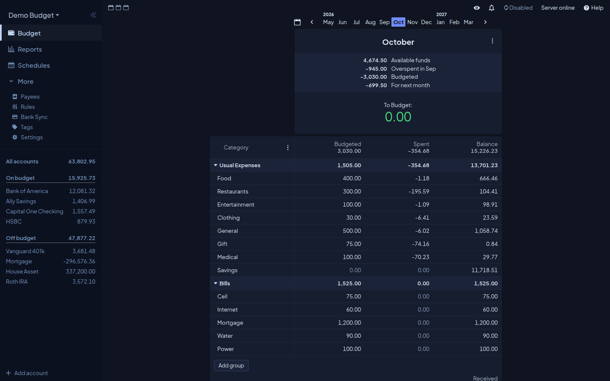
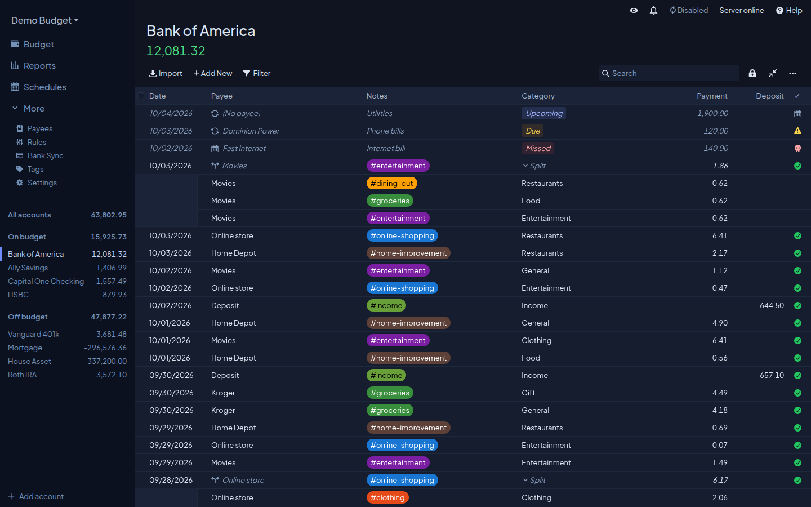
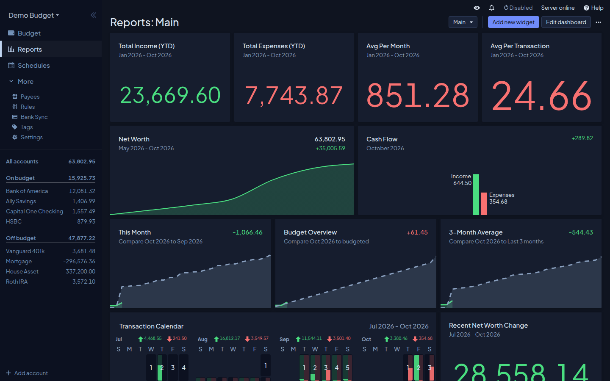
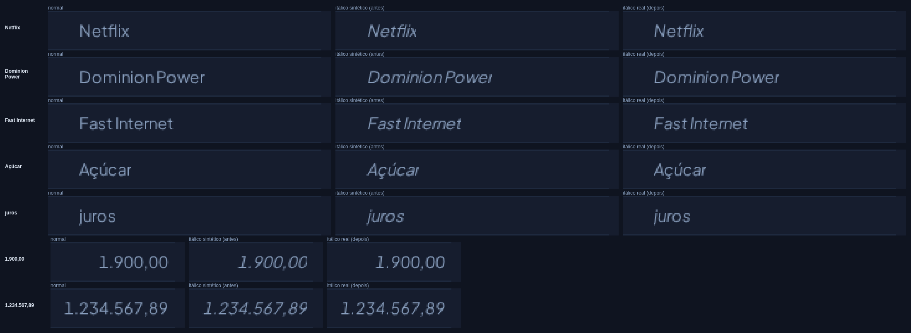

# Actual+ — tema para o Actual Budget

Tema escuro para o [Actual Budget](https://actualbudget.org) com a paleta, a tipografia e a
semântica de cor do [Actual+](https://actualpl.us): fundo azul-noite, acento cobalto-índigo,
**Plus Jakarta Sans** e a mesma regra de dinheiro (verde entra, vermelho sai).



| Transações | Relatórios |
| --- | --- |
|  |  |

Testado no Actual **26.10.0** (versão suportada, validação bloqueante no CI). Cobre as 237
variáveis `--color-*` dos temas embutidos e passa no validador oficial de temas do Actual. Uma
checagem separada confere a compatibilidade com o `master` (ver [Versões](#versões-validadas)).

## Instalar

O Actual só instala pelo repositório os temas que estão no catálogo oficial. Até este entrar
lá, o caminho é colar o CSS:

1. Abra [`dist/actual-plus-override.css`](dist/actual-plus-override.css) e copie tudo
   ([raw](https://raw.githubusercontent.com/csantiviago/actual-plus-theme/main/dist/actual-plus-override.css)).
   As fontes já vão embutidas nele.
2. No Actual: **Settings → Themes**, escolha **Dark** (ou **System default**, que usa o tema
   escuro à noite).
3. No seletor de tema escuro, escolha **Custom theme**.
4. Em **Additional CSS overrides**, cole o CSS e clique em **Apply**.

Para desfazer: apague o texto da caixa e clique em **Apply**.

**Já tinha colado uma versão anterior?** Ela só trazia a fonte reta. Para ter o itálico real
(agendamentos, categorias "Split"), apague o CSS antigo, cole de novo o conteúdo atual de
`dist/actual-plus-override.css` e clique em **Apply**. Instalando pelo catálogo, o Actual baixa
`actual.css` e as fontes do repositório sozinho.

> O override vale para qualquer tema, inclusive o Light. Como o Actual+ só tem paleta escura,
> use com o tema escuro — no Light você terá um Light com cara de Dark.

### Pelo catálogo

Quando o tema estiver no catálogo: **Settings → Themes → Custom theme** e clique em
**Actual+**. A entrada proposta para `customThemeCatalog.json` é:

```json
{
  "name": "Actual+",
  "repo": "csantiviago/actual-plus-theme",
  "colors": ["#0f1420", "#161d2e", "#6f8bfa", "#dde6f2", "#4ade80", "#f87171"],
  "mode": "dark"
}
```

## O que muda

| Papel | Actual+ | Variáveis do Actual |
| --- | --- | --- |
| Fundo | `#0f1420` | `pageBackground`, `mobilePageBackground` |
| Superfície (cards, tabelas, modais) | `#161d2e` | `tableBackground`, `cardBackground`, `modalBackground` |
| Superfície elevada | `#1a2338` | `tableHeaderBackground`, `menuBackground`, `tooltipBackground` |
| Sidebar | `#0c1120` | `sidebarBackground`, `mobileNavBackground` |
| Bordas | `#1e293e` / `#263450` / `#314060` | `tableBorder`, `menuBorder`, `buttonNormalBorder` |
| Texto | `#dde6f2` / `#a8b5c8` / `#899fbe` | `pageText`, `pageTextLight`, `pageTextSubdued` |
| Acento | `#6f8bfa` (hover `#a7b7ff`) | `buttonPrimaryBackground`, `pageTextLink`, seleções |
| Entrou / saiu | `#4ade80` / `#f87171` | `numberPositive`, `numberNegative` |
| Alerta | `#fbbf24` | `warning*`, `templateNumberUnderFunded` |
| Gráficos | paleta das zonas (Fixos, Investimentos, Reserva, Gasto livre…) | `chartQual1`–`chartQual9` |
| Fonte | Plus Jakarta Sans 400–800, normal e itálico | `--font-family`, `@font-face` |

Botão primário usa tinta escura sobre o acento, como no Actual+: branco sobre `#6f8bfa` dá
3,1:1 e reprova AA; `#0f1420` dá 5,9:1.

## Itálico

O Actual mostra em itálico as transações agendadas (previews) e alguns rótulos. Até aqui o tema só
trazia as faces `normal`, e o navegador **sintetizava** a inclinação; agora há faces `italic` reais
(400–800, ver [`fonts/FONTS.md`](fonts/FONTS.md) para origem, versão e licença).



### O que foi medido (e o que não foi)

Os testes usam uma fixture com o DOM/CSS das células de transação do Actual v26.10.0 (`overflow:
hidden` no texto e no wrapper do payee). **Não é o Actual completo.** Medido no Chromium, tamanho 13 px,
contando píxeis de tinta que só aparecem sem o recorte:

- Valores em itálico (`1.900,00`, `120,00`): o corte do último dígito (4–6 px) **some** (0 px).
- Nomes: o corte diminui (ex.: Netflix 3→1 px, Stuff 4→1 px, Fast Internet 1→0 px), mas **não some em
  todos** (ex.: "juros" continua com 3 px). Fonte real não garante que todo corte desapareça.
- O estilo normal fica idêntico pixel a pixel.
- `1.234.567,89` em coluna estreita (80 px) leva reticências com ou sem itálico: é corte por largura
  da coluna (o Actual estima ~7 px por caractere), não de fonte.

Firefox foi exercitado só na investigação anterior; WebKit/Safari não foi testado. Devices com
`deviceScaleFactor` maior medem densidade de pixels, não zoom de interface.

### Limites do formato de tema

O formato nativo do Actual aceita só `@font-face` e variáveis em `:root`; o validador rejeita
seletores. Por isso o tema **não** acrescenta `padding`, `overflow` ou regras por componente — e
não deve: remover `overflow` globalmente poderia sobrepor colunas. Se o corte residual precisar de
folga interna, a correção é no componente do Actual (ou numa camada de CSS externa fora do formato
de tema), não aqui. Também não é o tema que decide as reticências: elas vêm do `text-overflow` do
Actual.

## Diferenças intencionais em relação ao Actual+

- Realces e hovers com alpha (`sidebarItemBackgroundSelected`, `settingsNavItemBackground*`…) usam
  `rgba()` ou cor opaca misturada sobre a superfície; o validador do Actual não aceita `color-mix()`.
  A intensidade pode diferir um pouco da do Actual+.
- `chartQual1`–`chartQual9` carregam as cores da marca (zonas do Actual+). Mas o Actual decide qual
  categoria recebe qual cor; **isso não garante a mesma identidade semântica do Actual+**
  (ex.: "Fixos" azul).

## Versões validadas

| Checagem | Referência | Comportamento no CI |
| --- | --- | --- |
| `node scripts/validate.mjs` | Actual **v26.10.0** | bloqueante |
| `node scripts/validate.mjs --compat` | `master` | job separado, não obrigatório; **falha de verdade** se o master quebrar o tema ou trouxer variáveis sem mapeamento |

O `master` acrescentou 9 variáveis `--color-settings*` (cartões e navegação das Configurações). O
tema já as mapeia (na 26.10.0 elas são ignoradas), então a checagem de compatibilidade passa hoje.

## Desenvolver

Os tokens moram em [`scripts/build.mjs`](scripts/build.mjs). `actual.css` e
`dist/actual-plus-override.css` são gerados — não edite à mão.

```sh
npm install                    # devDependencies: playwright e subset-font
npx playwright install chromium
node scripts/build.mjs         # gera actual.css e dist/actual-plus-override.css
node scripts/build.mjs --check # falha se os gerados estão velhos
npm run validate               # validador oficial do Actual v26.10.0
npm run validate:master        # compatibilidade com o master
npm test                       # testes estáticos + tipográficos (Chromium)
node scripts/compare-italic.mjs docs/comparacao-italico.png   # refaz a figura acima
```

`validate.mjs` precisa de Node ≥ 22.18. Para outra versão: `ACTUAL_REF=<tag> node scripts/validate.mjs`.
Lint e typecheck: não há (projeto sem TypeScript); `node --check` nos `.mjs`.

Para testar mudanças sem publicar, cole o `dist/actual-plus-override.css` gerado no Actual
como descrito acima.

## Licença

Tema: MIT. Fonte Plus Jakarta Sans (normal e itálico): SIL Open Font License 1.1 ([`fonts/OFL.txt`](fonts/OFL.txt)).
Não é um projeto oficial do Actual Budget.
